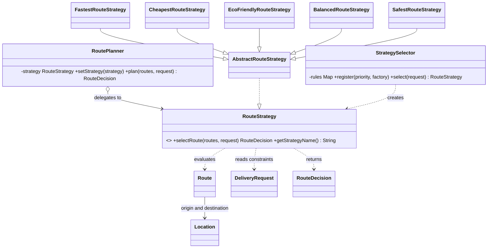
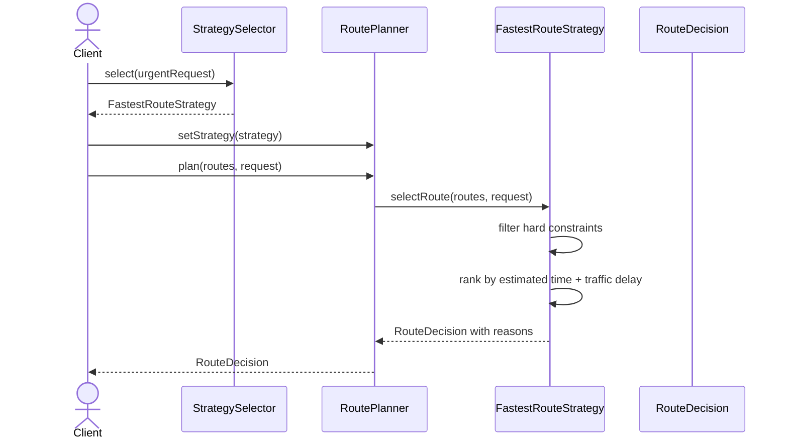

# Smart Delivery and Route Optimization Engine

**Student:** Nurakhmet Mukhtiar  
**Group:** SE-2517  
**Course assignment:** Assignment 5 — Strategy Pattern  
**Java:** 17+

## Problem and solution

A delivery request can favor speed, cost, environmental impact, or a weighted balance. The Strategy Pattern puts each route-selection algorithm behind `RouteStrategy`; the same `RoutePlanner` delegates to whichever strategy is currently selected. This avoids embedding algorithm branches in the context and lets a new algorithm be added as a separate class.

## Architecture

- **Context:** `planning/RoutePlanner.java` holds a `RouteStrategy` and delegates `plan` to it.
- **Strategy abstraction:** `strategy/RouteStrategy.java` defines selection and a display name.
- **Concrete strategies:** `FastestRouteStrategy`, `CheapestRouteStrategy`, `EcoFriendlyRouteStrategy`, `BalancedRouteStrategy`, and the added `SafestRouteStrategy`.
- **Automatic selection:** `selection/StrategySelector.java` maps request priority to an extensible strategy factory registry. Urgent selects Fastest, Economy selects Cheapest, and Standard selects Eco when eco is preferred or Balanced otherwise.
- **Decision explanation:** each result is a `RouteDecision` containing the selected route, score explanation, and rejection reasons.
- **Domain:** `Route`, `Location`, `DeliveryRequest`, and `DeliveryPriority` model business concepts.

### UML class diagram



### UML sequence diagram



## Algorithms and business rules

All strategies share the hard-constraint filter: unavailable routes, prohibited hazardous cargo, cost above budget, effective time above deadline, and emissions above the request limit are rejected before ranking. If no route remains, `NoSuitableRouteException` explains the failure. An empty candidate list produces the same explicit exception.

- **Fastest:** minimizes `estimatedMinutes + trafficDelayMinutes`.
- **Cheapest:** minimizes `baseCost + distanceKm × costPerKm + priority surcharge`. Priority surcharges are +1500 for urgent, 0 for standard, and -200 for economy.
- **Eco:** minimizes `0.8 × carbonEmissionKg + 0.2 × distanceKm` by default. The environmental scoring belongs in the Strategy because it is a route-selection algorithm and can vary independently of the context.
- **Balanced:** normalizes time, total cost, distance, and emissions across eligible routes to [0, 1], then sums each normalized value times its configured weight. Defaults in the demo are 0.40, 0.30, 0.10, and 0.20. The constructor rejects negative, non-finite, or non-unit-sum weights.
- **Safest (fifth strategy):** uses a transparent proxy score `0.6 × effectiveMinutes + 10 × carbonEmissionKg`; lower is preferred. It reuses the hard-constraint filter without changing `RoutePlanner`.

`StrategySelector` chooses *which* algorithm matches the request. A Strategy decides *how* to rank candidate routes. The selector uses registered factories, so additional mappings can be registered without adding a large conditional to the planner.

## Runtime switching and comparison

`DeliveryApplication` uses one `RoutePlanner` instance and switches it through Fastest, Eco, and Cheapest strategies at runtime. It also compares four strategies on the same request and eight candidates. Run the demo with:

```sh
mvn test
mvn package
java -cp target/classes kz.edu.se2517.delivery.demo.DeliveryApplication
```

Example output:

```text
DELIVERY REQUEST #105
Fastest: R2 | 22 min | 1760.00 | Estimated time 20 min + traffic delay 2 min
Cheapest: R3 | 38 min | 1500.00 | Cost = base 400.00 + distance 10.0 km × 110.00/km + priority surcharge 0.00 = 1500.00
Eco friendly: R3 | 38 min | 1500.00 | Eco score = 0.80 × 1.20 kg CO2 + 0.20 × 10.0 km = 2.960
Balanced: R6 | 28 min | 1505.00 | Normalized weighted score 0.256 (time 0.40, cost 0.30, distance 0.10, emissions 0.20)

Runtime switching on the same RoutePlanner:
Fastest -> R2
Eco friendly -> R3
Cheapest -> R3
Automatic strategy for urgent request: Fastest
```

## Tests and failure cases

`RoutePlanningTest` contains 23 JUnit 5 tests covering all five strategies, normalized balance and invalid weights, three runtime changes, automatic selection, route availability, budget, deadline, emissions/hazardous restrictions, no-valid-route and empty-list failures, invalid domain data, result explanations, and strategy comparison. Verified locally with JUnit Platform 1.11.3: 23 tests passed, 0 failed. Maven is not installed in the authoring environment; on a Maven-equipped machine, run `mvn test` and Surefire writes results to `target/surefire-reports/`.

## Strategy Pattern, Bridge, and SOLID

This design uses Strategy because it swaps one behavior (route selection) at runtime behind a common interface. Bridge separates two independently varying hierarchies, typically an abstraction and an implementation dimension; the key relationship here is an interchangeable algorithm delegated to by one context.

- **SRP:** planner delegates, strategies rank routes, selector chooses the algorithm, and domain records hold business data.
- **OCP:** add another `RouteStrategy` implementation without editing `RoutePlanner`; the fifth strategy demonstrates this.
- **DIP:** `RoutePlanner` depends on the `RouteStrategy` abstraction.

## Limitation

The demo uses a small in-memory candidate set and fixed coefficients. Production routing would need live traffic, calibrated emissions/cost data, and explicit stakeholder validation of the scoring weights. The safety score is an educational proxy, not a certified safety model.

## Git history

The repository contains 11 meaningful commits: project setup, domain model, Strategy/decision abstractions, Fastest and Cheapest, Eco and Balanced, planner and selector, fifth strategy, runtime demo, tests, and documentation.
